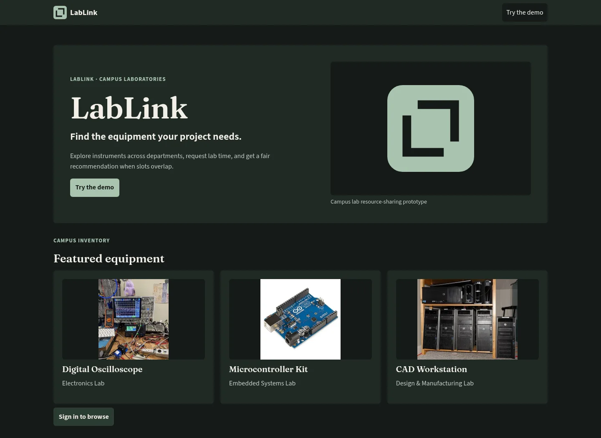
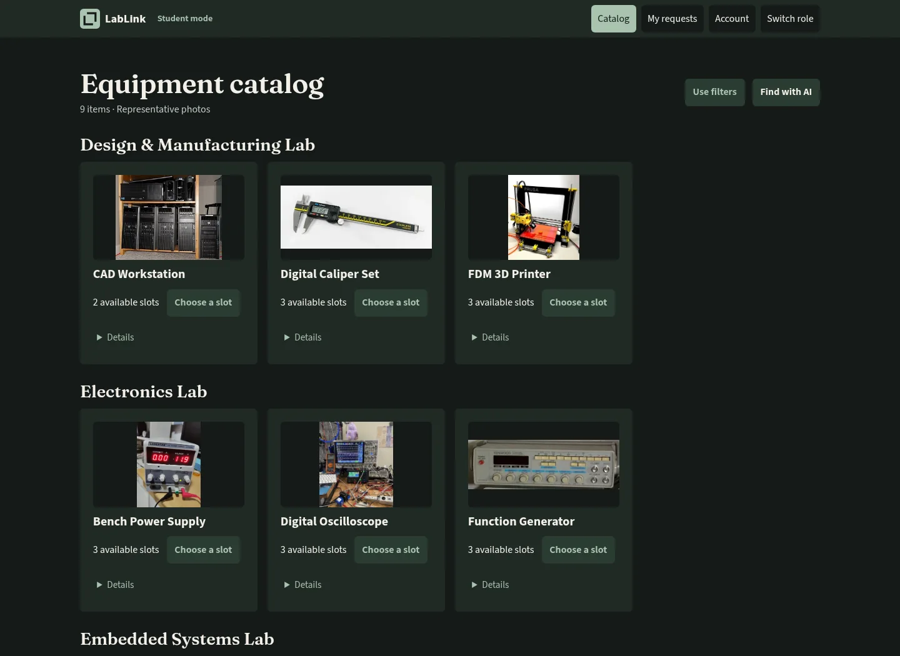
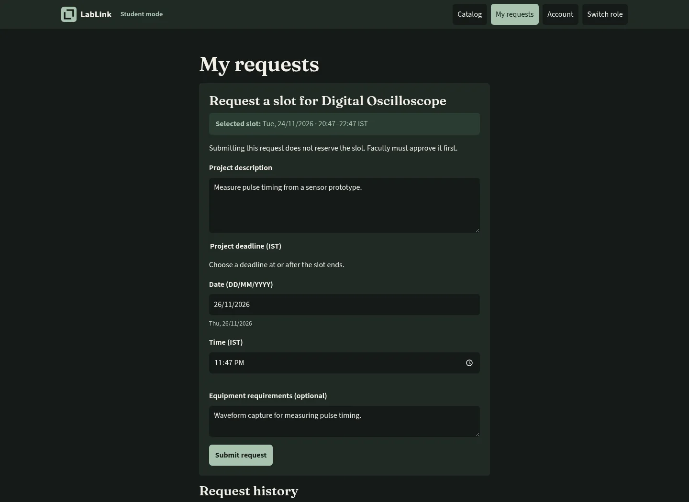
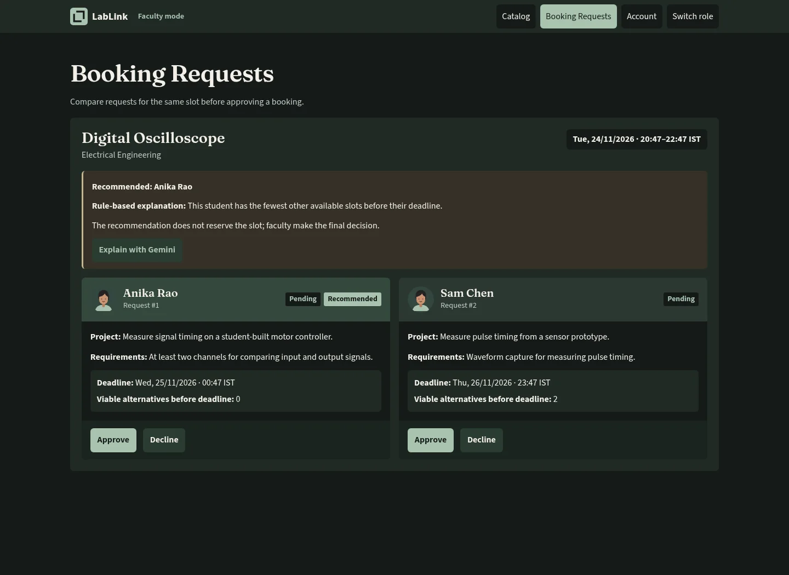

# LabLink

[](https://github.com/Synergy1610/LabLink/actions/workflows/ci.yml)

**A campus lab equipment booking prototype for students and faculty.** LabLink helps students discover equipment across departments, request faculty-approved access, and understand fair recommendations when requests conflict.

> **Prototype notice:** The catalog and accounts are fictional sample data. The hosted demo is disposable and is not intended for real bookings or personal information.

## Features

- Browse and filter sample equipment across labs and departments.
- Request a time slot with a project deadline and requirements.
- Rank competing requests by fewest viable alternatives, then earliest deadline, then earliest submission.
- Require a faculty decision for every booking; recommendations never approve automatically.
- Show a viable alternative when another request gets the slot.
- Optionally use Gemini for equipment matching and plain-language explanations; core booking works without AI.
- Use passwordless demo personas or locally provisioned student and faculty accounts.

## Screenshots

Captured from the public-demo landing page and local one-click student/faculty flows using fictional sample data. Select an image to view it at full size.

| Public landing page | Equipment catalog |
|---|---|
| [](docs/screenshots/lablink-landing.webp) | [](docs/screenshots/lablink-catalog.webp) |
| Student request form | Faculty conflict recommendation |
| [](docs/screenshots/lablink-request.webp) | [](docs/screenshots/lablink-faculty.webp) |

## Stack

Node.js 26, Express 5, EJS, SQLite (`node:sqlite`), and plain CSS/JavaScript. No frontend build step or external database is required for local development.

## Quick start for reviewers

Use **Node.js 26** and npm. From a fresh clone, run `npm ci`, then choose one of the two sign-in options below. No external database or API key is required for the core flow. Stop one server before starting the other, or use a different `PORT`.

### 1. One-click demo

Run `npm run demo` and open <http://127.0.0.1:3000/sign-in>. There are no credentials to enter. **Switch role** changes accounts in the same sandbox; restarting the demo resets all its data.

#### Try a scheduling conflict

1. Click **Try as Student · Sam Chen** and then **Open demo booking**. Anika already has a pending request for the first **Digital Oscilloscope** slot.
2. Submit the prefilled request. Sam's deadline is after the last oscilloscope slot; all dates use **DD/MM/YYYY** and times are **IST**.
3. Use **Switch role → Try as Faculty · Dr. Mira Patel**, then open **Booking Requests**. LabLink recommends Anika because she has **0** alternatives and Sam has **2**. If Gemini is configured, try **Explain with Gemini** before approving.
4. Approve Anika. Switch back to Sam and open **My requests**. It shows **Slot taken** and offers the earliest viable alternative. Submitting it creates a new pending request.

### 2. College ID and password

Run `npm run review` and open <http://127.0.0.1:3000/sign-in>. Use these **public test credentials**:

| Role | College ID | Password |
| --- | --- | --- |
| Student | `REVIEW-STUDENT` | `ReviewStudent26!` |
| Faculty | `REVIEW-FACULTY` | `ReviewFaculty26!` |

These accounts are for **local evaluation only**. This shortcut uses the same password authentication as `npm start` but creates isolated in-memory data, with no preset bookings. Try submitting a request as the student, then sign out and approve it as faculty. Restarting resets the review data. These credentials do not apply to `npm start`.

## Architecture and booking rules

Express and EJS serve the app; Node's built-in SQLite stores slots, requests, and bookings. Students choose an available slot and enter a project deadline. A pending request does not reserve the slot. For competing requests, LabLink counts the other open slots for the same resource that finish by each student's deadline. It ranks requests by fewest alternatives, then earliest deadline, then earliest submission. Faculty can accept or override the recommendation. Approval is transactional so two decisions cannot book the same slot; after approval, students can request a viable alternative if one exists.

Equipment is grouped by lab. **Details** expands the descriptions and capabilities for a row. **Use filters** opens the search and lab filters, and **Find with AI** opens optional Gemini matching for students. **Choose a slot** opens the date and time picker. Without JavaScript, navigation and browse tools appear inline, details expand individually, and slot selection uses a standalone picker.

## Assumptions and scope

- The catalog and slots are sample campus data, not connected to a live inventory or calendar. All times use IST and dates use `DD/MM/YYYY`.
- Each request is for one slot on one resource. Faculty make the final decision; the recommendation and Gemini never approve bookings.
- The app runs locally, binds to `127.0.0.1`, and does not implement campus SSO or public signup.

## Cloud Run demo

The Docker image starts only the public one-click demo. It listens on Cloud Run's assigned `PORT`, does not use private accounts or Gemini, and gives each browser an in-memory sandbox. Sandboxes reset after inactivity or when the service restarts; the demo is not for real bookings.

The catalog counts available slots in SQLite instead of loading every slot. Conflict ranking sweeps candidate slots once in finish-time order while tracking the earliest eligible start, preserving the same booking rules. In a local synthetic benchmark with 4,000 added slots and 2,000 requests, both implementations returned identical rankings; median ranking time over five runs dropped from 343.7 ms to 3.4 ms.

The hosted demo caches static assets for 15 minutes, keeps session pages out of caches, and uses a same-origin content security policy. Each sandbox is capped at 64 booking requests, including seeded requests, to bound memory use.

From a clean clone in Cloud Shell, deploy to a billing-enabled project you control:

```sh
gcloud run deploy lablink-demo --source . --region asia-south1 \
  --allow-unauthenticated --min-instances 0 --max-instances 1
```

Open the resulting HTTPS URL and choose **Try the demo**. Check the student and faculty walkthrough in a private browser window before sharing the link.

The homepage uses the LabLink mark by default. For a local preview, place a school logo in ignored `data/` only if you have permission to use it; logos are not included in the repository or hosted demo.

## Persistent campus setup (optional)

Normal mode uses a separate persistent SQLite database at `data/normal.sqlite`. It has sample equipment and slots, but no preset accounts or requests. An administrator provisions each college ID and assigns its role. Use a **LabLink-specific** password of 12–128 characters, not an existing campus password.

In Bash, provision a student without putting the password in shell history or command arguments:

```bash
read -rsp 'New LabLink password: ' lablink_password; printf '\n'
printf '%s\n' "$lablink_password" | npm run provision -- STUDENT-001 student 'Student Name'
unset lablink_password
npm start
```

Use `faculty` in place of `student` and a different college ID to provision a faculty account. Open <http://127.0.0.1:3000/sign-in>. There is no public signup or password recovery flow. Both modes bind to localhost; use a narrow viewport in browser developer tools to try the mobile layout locally.

## Optional Gemini features

With a Gemini API key, students can get equipment matches from their project descriptions and faculty can request a plain-language explanation of a recommendation. Gemini cannot alter bookings. Without a key, catalog search, booking, and rule-based recommendations still work.

Copy `.env.example` to `.env`, set `GEMINI_API_KEY` locally, and restart. `GEMINI_MODEL` can optionally override the default model. `PORT` overrides the default `3000`. Never commit `.env` or send private data in a demo prompt.

## Development checks

```sh
npm ci
npm run demo       # passwordless sample walkthrough
npm run lint       # ESLint over server, tests, and browser JavaScript
npm test           # isolated automated tests
npm run check      # lint plus all tests; also run by GitHub Actions
```

Tests use isolated databases and stub Gemini; no key or live network call is needed. See [architecture](docs/ARCHITECTURE.md), [contributing](CONTRIBUTING.md), [security policy](SECURITY.md), and [photo credits](docs/PHOTO_CREDITS.md). Original event planning documents are retained as historical context in `docs/`.

## License

Original LabLink code and documentation are available under the [MIT License](LICENSE). Third-party photos and fonts retain their respective licenses; see [photo and font credits](docs/PHOTO_CREDITS.md). Dependencies are governed by their own licenses.
